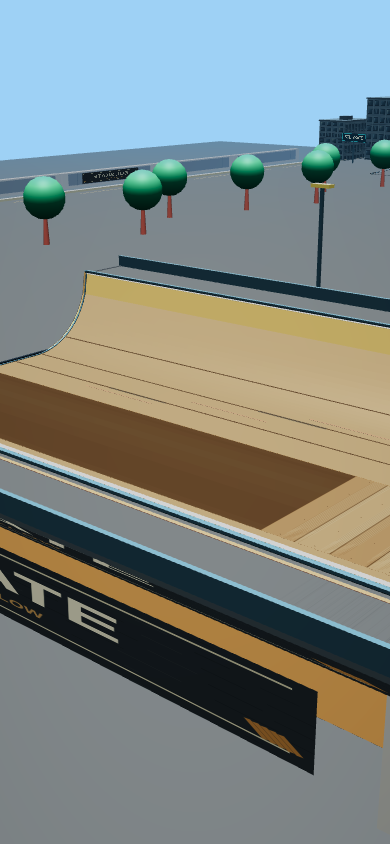

# Local architecture batching: validation and experiment

This branch remains unmerged. Fewer draw submissions are verified; a device speedup has not been established. The earlier sequential timing experiment is preserved in [legacy/](legacy/README.md) and is not used to infer performance on current main.

## Current geometry and rendering

The baseline fixture is the unbatched component from main `cc81a51`. Both variants contain the current mural artwork and V2 ollie-tuck rider. Architecture becomes 63 meshes instead of 150, and the full scene becomes 349 instead of 436 (87 fewer objects, about 20%). Only opaque, noninteractive component geometry is batched by material, shadow-receiver flag, and 40m spatial cell. Named mural planes remain independent.

The unit test compares indexed world-space triangles, winding, normals, UVs, materials and shadow flags at 1mm positional precision. It also checks local bounds and component disposal. The component owns five materials and one atlas; its dispose method now releases those as well as its meshes. The production call site builds the component once during page initialization; restarting a run does not rebuild the scene. The baseline's incomplete material disposal predates batching.

The browser test now requires exact equality of every RGB pixel. It compares six cameras at desktop 960×720 and mobile 390×844: spawn, park, both perimeter walls, halfpipe, and a rider standing on the deck. Physics is frozen after a deterministic idle pose; the real rider, shadows and current artwork remain visible. Only the HUD is hidden. All 12 comparisons passed with zero channel difference.

Direct WebGL draw calls are counted and cross-checked against Babylon's per-render counter. `SceneInstrumentation` resets that counter before each render, so current is read after the render rather than subtracting a previous frame. The previous static/whole-game tables also differed in viewport, rider visibility and shadow passes; their totals were never interchangeable.

| Fixed-pose view | Desktop GL draws before/after | Mobile GL draws before/after |
|---|---:|---:|
| Spawn | 157 / 157 | 121 / 121 |
| Park | 213 / 187 | 113 / 103 |
| Left wall | 106 / 75 | 89 / 61 |
| Right wall | 110 / 79 | 87 / 58 |
| Halfpipe | 141 / 114 | 97 / 80 |
| Rider on deck | 152 / 122 | 113 / 102 |

The small increase in active indices at cell boundaries is retained in the raw visual results. Batching never removes geometry.

## Paired timing protocol

`tools/render_budget_paired.cjs` measures the render path with simulation frozen. It does not measure FPS, animation speed, or physical mobile performance. The previous wall-clock full-game profiler remains an exploratory tool: its physics substep count depends on host frame intervals and it must not be used to estimate animation savings on a 60 FPS device.

- One Chromium process, eight blocks per viewport. Each block uses ABBA or BAAB plus two baseline A/A control runs, with a fresh page for every run. The entire first block is discarded.
- All five original camera views are timed, including the previously untimed wall and halfpipe views.
- Each camera uses a fixed projection at both a 64×64 render target and full resolution. Rider and shadows are disabled in **both timing conditions**, isolating architectural submission and raster work without a large shadow-map fill cost at 64×64. Rider/shadow preservation is tested separately above.
- Three warm-up renders and five measured renders per condition. Each sample ends with a 1×1 readPixels synchronization. Submission time, synchronized time, sync wait, Babylon render time, active-mesh evaluation time, active indices and GL draw counts are recorded.
- GL-counting wrappers are removed during timed samples. Timing therefore does not include per-draw JavaScript counting overhead.
- A fixed-work JS canary runs before and after each page's measurements, using the median of five batches after ten warm-up calls. A whole block is excluded if any canary differs by more than 10% from the session median. Rejected data remains in the raw report.
- Inference uses block-level paired median percent changes and a seeded 10,000-resample bootstrap 95% interval. Frames within a page are not treated as independent pairs. At least four accepted blocks are required for an interval.
- A submission signal requires lower GL draw counts, both render-time and synchronized-time intervals below zero, and improvements exceeding the corresponding A/A spread. Full-resolution equivalence requires the synchronized interval to lie entirely within a predefined ±5% margin and A/A noise no larger than 5%. An interval merely covering zero does not establish equivalence.
- Three scratch-scene build/dispose measurements per page record construction cost, disposal cost, retained materials and retained atlas. Scratch scenes are then fully cleaned to prevent the baseline's lifecycle leak from affecting subsequent samples.

The raw report records flags, Chromium version, CPU count and OS load averages. Windows does not expose loadavg through Node, so those zeros are explicitly marked unavailable. All local browser rendering uses SwiftShader. Host drift, GPU-driver waits and the readback itself remain limitations; no result supports a claim about phones.

The full paired run and its accepted/rejected counts will be recorded in `paired-result.json`. Insufficient accepted blocks will be reported as inconclusive, without relaxing rejection thresholds.

## Reproduce

Install the existing test dependencies and Chromium:

```text
npm install --no-save playwright@1.55.1 babylonjs@8
npx playwright install chromium
node tests/park_architecture.cjs
node tests/render_budget_statistics.cjs
node tests/render_budget_browser.cjs
node tools/render_budget_paired.cjs
```

`RENDER_PAIRS` defaults to 8 and `RENDER_SAMPLES` to 5. A two-block/one-sample harness check verifies execution but cannot establish a timing conclusion. Reports and screenshots are written under `test-artifacts/render-budget/`. The normal acceptance workflow runs the geometry and exact-pixel checks; the longer timing experiment is a deliberate local run.

## Animation work is deferred

V2 retargeting is unchanged. Its heavy bone writes occur inside physics substeps, but the same function observes landing transitions and applies landing decay. A single call after the loop would lose intermediate landings and can change the rendered pose. Before implementing a split, profile V2's actual share at 1/2/4/10 substeps and compare final palettes, joints, feet, grab contact and landing decay across intermediate land/launch sequences. No animation saving is claimed from this batching experiment.




