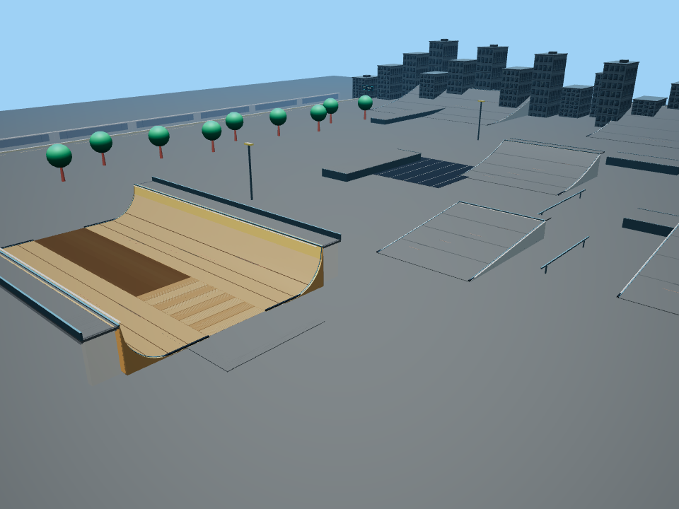

# Render budget evidence

Tested production commit: 6450e58a6f955e3b4eca0569aed19abb4336f48c. Before uses the unchanged architecture fixture from main 69f885c; after uses the batched module. Both runs use the same checkout, browser, locally routed Babylon bundle, cameras and viewports.

## Focused change

Batch only opaque, noninteractive architecture by material and 40m spatial cell, then freeze those static world matrices. Architecture meshes: 142 to 55; complete scene: 428 to 341 (20.3% fewer mesh objects). Total indexed geometry and materials are preserved. Riding surfaces, colliders, rails, rider animation, input and physics code are unchanged.

## Full game measurements

Chromium 140.0.7339.186, Babylon 8.56.2, SwiftShader software rendering. Desktop 1280x800; mobile emulation 390x844. Each view uses 20 warm-up frames and 40 measured frames. Numbers below are medians except callback p95.

| View | Draw calls before/after | Active meshes before/after | Callback ms before/after | Callback p95 ms before/after | Frame interval ms before/after |
|---|---:|---:|---:|---:|---:|
| desktop-spawn | 168 / 166 | 149 / 147 | 6.9 / 7.3 | 18.2 / 12.2 | 409.3 / 478.2 |
| desktop-park | 227 / 197 | 208 / 178 | 7.6 / 7.0 | 13.7 / 15.0 | 388.3 / 423.1 |
| mobile-spawn | 121 / 121 | 103 / 103 | 6.6 / 7.0 | 9.4 / 10.5 | 101.3 / 108.5 |
| mobile-park | 111 / 101 | 97 / 87 | 5.5 / 6.6 | 17.6 / 17.3 | 87.0 / 94.1 |

Startup (navigation through engine readiness and first five frames): desktop 1651.4 / 2477.9 ms; mobile 2284.3 / 2172.2 ms. These are one startup sample per run, and should not be interpreted as a reliable startup improvement.

Software rasterization and host contention dominate these timings. Timing results are mixed; this PR claims measured draw-call and scene-object reductions, not universal FPS gains or physical mobile performance. The mobile spawn draw count is unchanged. Texture count, shadow resolution, geometry detail and shader quality remain unchanged.

## Visual and gameplay verification

The static A/B test hides the moving rider and HUD only for deterministic screenshots. Across desktop 960x720 and mobile 390x844, five cameras each (spawn, park, left wall, right wall, halfpipe), all 10 images are pixel-identical. The test permits at most 0.1% of pixels differing by more than 2 channel levels; this run changed zero pixels. Separate production browser suites include the rider and full gameplay.

| Static view | Draw calls before/after | Changed pixels |
|---|---:|---:|
| desktop-spawn | 104 / 104 | 0 |
| desktop-park | 156 / 130 | 0 |
| desktop-left-wall | 89 / 58 | 0 |
| desktop-right-wall | 93 / 62 | 0 |
| desktop-halfpipe | 123 / 96 | 0 |
| mobile-spawn | 68 / 68 | 0 |
| mobile-park | 88 / 78 | 0 |
| mobile-left-wall | 73 / 45 | 0 |
| mobile-right-wall | 71 / 42 | 0 |
| mobile-halfpipe | 80 / 63 | 0 |

Local spatial batching can submit a few extra offscreen triangles at cell boundaries (at most 0.31% more active indices in these static views), while reducing draw submissions. It never removes geometry. The unit test compares indexed world-space triangles, winding, normals, UVs and material properties at 1mm positional precision and checks disposal/local bounds.

Passed: park_architecture.cjs; render_budget_browser.cjs; ramp_grind_browser.cjs; skater_v2_browser.cjs; controls_help_browser.cjs; browser_smoke.cjs; all existing controller, terrain, obstacle, grind, motion, wheel, landing, board, push, ramp, halfpipe, input and bowl logic tests. Physical mobile/Xbox hardware and other browsers remain untested.

## Reproduce

Install the existing browser test dependencies (`npm install --no-save playwright@1.55.1 babylonjs@8`) and Chromium (`npx playwright install chromium`). Run `node tests/park_architecture.cjs` and `node tests/render_budget_browser.cjs`. For the timing profile, set PERF_FRAMES=40 and run `node tools/render_budget_profile.cjs before`, then `node tools/render_budget_profile.cjs after`. Default is 60 measured frames. Raw rows and screenshots are written under test-artifacts/render-budget/.

